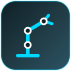
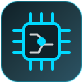
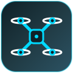

  

---

# 💫 About Me:
🎓 B.Tech ECE (AI & Cybernetics) @ **Vellore Institute of Technology, Bhopal** (2024 – 2028) 
🔭 I’m currently working on an **Autonomous Robotic Mobile Manipulator (5-DOF)** and a **custom ESP32 flight controller for rocketry avionics** 
👯 I’m looking to collaborate on open-source UAV flight stacks and custom PCB hardware projects 
🌱 I’m currently learning about UAV systems and avionics 
💬 Ask me about UAV telemetry (MAVLink, LoRa, SBUS), custom PCB design in KiCad, ArduPilot SITL, and ROS 2

## 🚀 Featured Projects:

<table align="center">
<tr>

<td align="center" width="33%">

  
<a href="https://github.com/Hazijul-rbot/REPO-NAME"><b>Autonomous Robotic Mobile Manipulator</b></a>
  
5-DOF arm, obstacle avoidance and pick-and-place
  

</td>

<td align="center" width="33%">

  
<a href="https://github.com/Hazijul-rbot/REPO-NAME"><b>Rocket Avionics Flight Controller PCB</b></a>
  
High-g ESP32 PCB with IMU, GPS, barometer and LoRa telemetry
  

</td>

<td align="center" width="33%">

  
<a href="https://github.com/Hazijul-rbot/REPO-NAME"><b>Custom Autonomous RC Quadcopter</b></a>
  
Custom 2.4 GHz TX/RX, PID tuning and MAVLink telemetry
  

</td>

</tr>
</table>

## 🌐 Socials:
 

# 🛠️ Tech Stack:

**Programming**

**Embedded & Hardware**

**Robotics, UAV & Protocols**

**CAD, Simulation & Tools**

# 📊 GitHub Stats:
 
 

## 🏆 GitHub Trophies

---

## 📫 Let's Connect

Open to **internships, research collaborations, and hardware/robotics projects** in UAVs, avionics, and autonomous systems.

